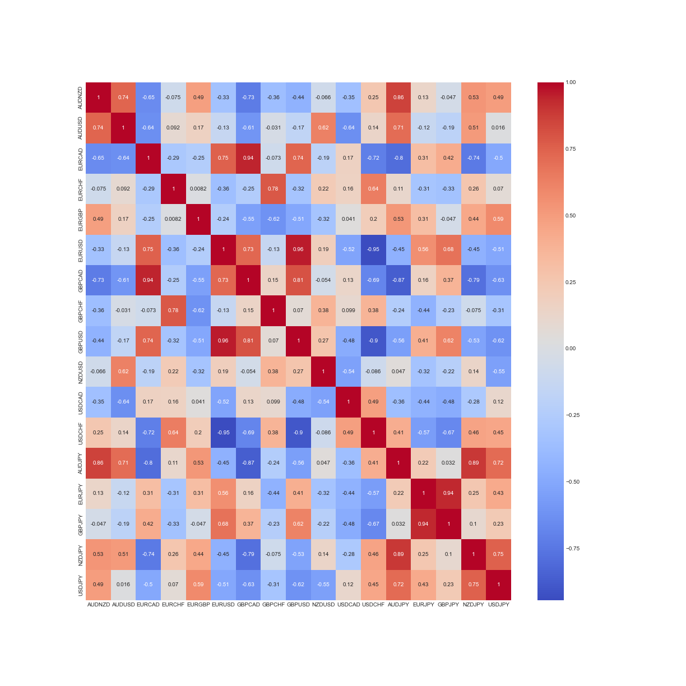

# Forex Correlation Explorer

**Historical currency-pair co-movement, with reproducible calculations and visible data-quality checks.**

A modernized version of my earlier Streamlit foreign-exchange correlation project. The original application correlated **closing-price levels** despite labeling its output as returns. The revised default measures **Pearson correlations of aligned percentage returns**, which better addresses short-period co-movement. Price-level comparison remains available as an explicitly labeled *exploratory* option.

This is an educational research tool, **not investment advice, a forecasting system, or a trading signal**.

## What it does

- **Three data sources:** deterministic synthetic example (works offline), uploaded CSV closing prices, or on-demand Yahoo Finance history.
- **Return-based analysis by default:** one-period `pct_change(fill_method=None)`, with no forward-filling of missing prices.
- **Transparent data checks:** validates dates, duplicate timestamps, positive numeric prices, and multiple columns.
- **Honest sample sizes:** pairwise overlapping observation counts and a configurable minimum (otherwise N/A).
- **Reviewable results:** heatmap, correlation table, source and observation previews, downloadable CSV.
- **Testable architecture:** separates the analysis engine (`analysis.py`) from market-data retrieval (`market_data.py`) and the Streamlit UI (`app.py`).



*Historical screenshot retained for provenance. It is not a screenshot of the modernized returns-based interface.*

## Run locally

Python **3.11+** recommended:

```bash
python -m venv .venv
# Activate the environment using your operating system's shell command.
python -m pip install -r requirements.txt
python -m streamlit run app.py
```

The **Synthetic demo** source is selected by default and needs no account, market-data credentials, or network connection.

To run the offline test suite:

```bash
python -m pip install -r requirements-dev.txt
python -m pytest -q
```

GitHub Actions also runs compilation and unit tests for pull requests and pushes.

## Upload your own price data

Upload a UTF-8 CSV with one `timestamp` (or `date`) column and at least two **wide-format closing-price columns**, for example:

```csv
timestamp,EURUSD,GBPUSD,USDJPY
2026-10-01,1.1732,1.3520,147.12
2026-10-02,1.1751,1.3480,147.64
2026-10-05,1.1725,1.3514,148.03
2026-10-06,1.1784,1.3561,147.80
```

*The small example above is illustrative, not authenticated market history. For 30-observation correlations, upload substantially more rows.*

- Dates must be valid and unique. The app sorts them chronologically.
- All selected price values must be positive; blank prices are allowed, but are never silently filled.
- Each series' percentage return is calculated between consecutive timestamps; align all pairs to the same observation frequency before upload.
- For missing or irregular intervals, returns are based on the preceding available **adjacent** row, not a guaranteed fixed-time duration. Check calendar spacing and avoid mixing frequencies.

## Yahoo Finance mode

The live-data option loads **historical prices on request**, rather than issuing network requests on every app rerun. It uses the `yfinance` library and explicitly maps pair names to Yahoo tickers (e.g. `USDJPY → JPY=X`).

Supported pairs: EURUSD, GBPUSD, AUDUSD, NZDUSD, USDJPY, USDCHF, USDCAD, EURGBP, EURJPY, GBPJPY.

Supported frequencies: daily, weekly, monthly. Windows: 6 months, 1, 2, or 5 years. Yahoo availability and data accuracy can vary; data can be delayed, unavailable, or rate-limited. Missing instruments are reported. The app is not a source of guaranteed live exchange quotes.

Sources: [yfinance documentation](https://ranaroussi.github.io/yfinance/reference/api/yfinance.Tickers.html) · [Yahoo Finance currency symbols](https://finance.yahoo.com/markets/currencies/).

## Interpretation and limitations

**Return correlations vs price levels:** Price levels can share trends and show misleadingly high correlation. One-period percentage returns are the default and are more defensible for cross-pair co-movement.

**Pearson correlation:** Ranges from -1 to +1. It is symmetric, does not measure causality, and cannot establish profitability or reliable future relationships. FX pair direction matters (e.g., USDJPY vs EURUSD).

**Missing observations:** Each pair uses only mutually available timestamps. Missing prices are not forward-filled; all calculations expose the number of overlapping observations. When sample size is insufficient or either series has zero variance, correlation shows N/A.

**Synthetic sample:** Generated with a fixed random seed, approximately FX-like but fully fictional. It must never be presented as sourced market data.

**External-data caveats:** Yahoo data terms and reliability are controlled by its provider. Historical correlations can change with windows, market regime, and currency quotation convention.

## Repository layout

| Path | Purpose |
| --- | --- |
| `app.py` | Streamlit UI and user-controlled fetch |
| `analysis.py` | Pure price validation, return calculations, and correlation |
| `market_data.py` | Optional external historical-data adapter and ticker mapping |
| `tests/` | Offline deterministic regression tests |
| `.github/workflows/ci.yml` | Compile and test in CI |
| `CorrelationMatrix.ipynb` | Original research notebook, preserved |
| `Images/CorrelationMatrix.png` | Historical screenshot, preserved |

## Deployment

The Streamlit application entry point is **`app.py`**. A prior deployment link was published at [forexcorrelationmatrix.streamlit.app](https://forexcorrelationmatrix.streamlit.app/); its current accessibility and the new version's deployment have **not** been verified. Deployments should be checked after merging, not assumed.

## Project history

This repository intentionally retains its original notebook, history, and screenshot. Modernization focuses on correctness, transparent assumptions, simpler setup, and reproducible tests rather than rewriting earlier experiments as production systems.
